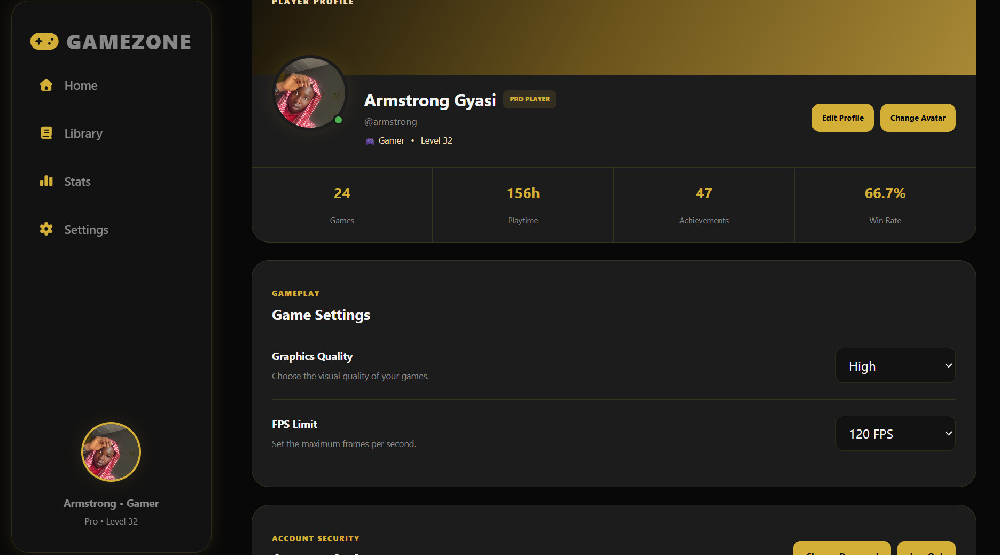
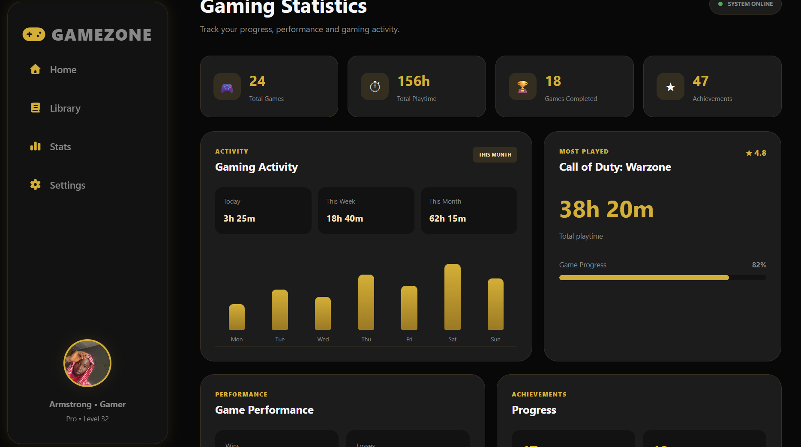
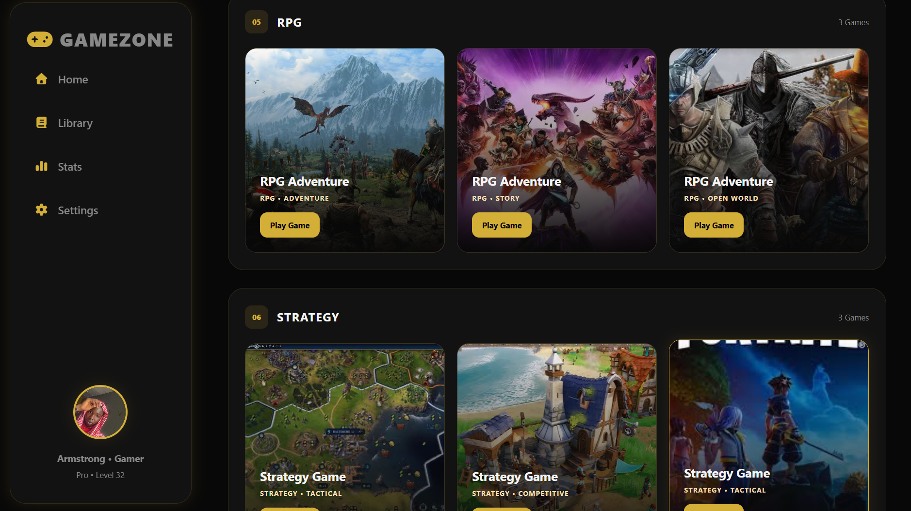
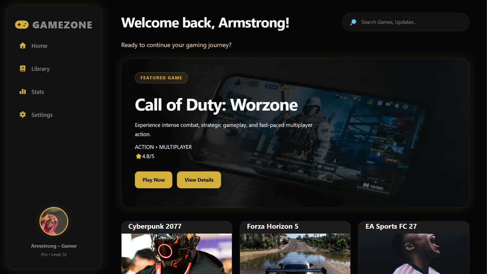
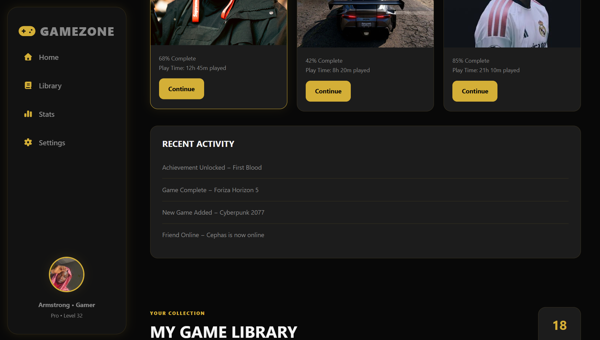

# 🎮 GAMEZONE

A modern, responsive gaming dashboard built with **HTML and CSS**.

GAMEZONE is a frontend web-development project designed to provide a clean gaming dashboard experience where users can explore games, view statistics, manage settings, and track their gaming activity.

## 🚀 Features

* 🎮 Featured game section
* 📚 Game library
* ▶️ Continue playing section
* 🕹️ Current games
* 📊 Gaming statistics
* 🏆 Achievements
* ⚙️ Settings page
* 👤 User profile section
* 📱 Responsive design for desktop, tablet, and mobile
* 🌙 Modern dark gaming interface
* 🟡 Gold-accented UI design

## 🛠️ Technologies Used

* **HTML5**
* **CSS3**
* **Font Awesome**
* **Responsive Web Design**
* **CSS Grid**
* **CSS Flexbox**

## 📁 Project Structure

```text
GAMEZONE/
│
├── index.html
├── README.md
├── .gitignore
│
├── css/
│   └── style.css
│
├── js/
│   └── script.js
│
├── assets/
│   ├── images/
│   │   ├── logo.png
│   │   ├── games/
│   │   └── backgrounds/
│   │
│   └── icons/
│
└── screenshots/
    └── preview.png
```

## 🎯 Project Goals

The goal of this project is to practice and demonstrate frontend development skills, including:

* Building structured web pages with HTML
* Creating responsive layouts with CSS
* Using CSS Grid and Flexbox
* Creating reusable UI components
* Designing modern interfaces
* Organizing a real-world web project
* Preparing a project for deployment and GitHub

## 📱 Responsive Design

GAMEZONE is designed to work across:

* 💻 Desktop
* 💻 Laptop
* 📱 Tablet
* 📱 Mobile phones

## 🔮 Future Improvements

Planned improvements include:

* JavaScript functionality
* Functional navigation
* Search and filtering
* Interactive game cards
* User authentication
* Backend integration
* Database support
* Real game data/API integration
* User profiles and saved games

## 📸 Preview

*Add a screenshot of the GAMEZONE dashboard here.*

## 👨‍💻 Author

**Armstrong**

Aspiring Web Developer & Trader™

## 📄 License

This project is currently for learning and portfolio purposes.




